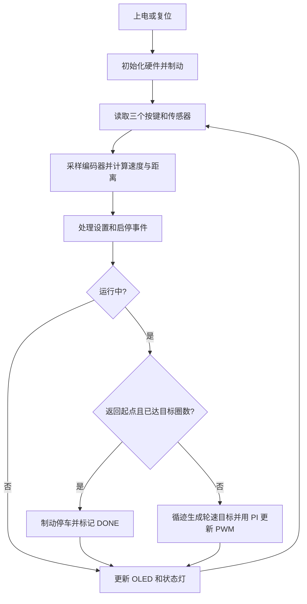

# car-for2：按键调速、定圈停车与 OLED 实测显示

独立项目位于 `D:\STM32project\car-for2`，由 `stm32-car` 扩展而来，主控仍为 STM32F103C8T6、8 MHz 外部晶振、72 MHz 系统时钟。原有 `stm32-car` 和 `stm32-item` 保持各自用途。

## 实现的任务

- 通过五路数字传感器沿闭环黑线循迹，左右两个后轮差速转向。
- 按键调节目标速度，默认范围 **0.100～0.550 m/s**，每次增加 **0.050 m/s**，超过上限回到下限。
- 按键调节目标圈数，范围 **1～9 圈**，超过 9 圈回到 1 圈。默认 1 圈、0.250 m/s。
- 从可识别的起点启动，离开起点后再次返回才计一圈，完成设定圈数后在起点检测区域制动停车。
- OLED 分别显示设定速度、编码器实测速度、本次累计行程、已完成圈数、目标圈数和运行状态。
- 随时按启停键手动停车；上电或 Reset 后保持停止。

**实际速度和距离必须有车轮编码器，起点停车必须有起点检测信号。** 默认使用双轮 AB 相编码器、SSD1306 128×64 I²C OLED，以及起点旁的一处磁铁和一个非锁存数字霍尔开关。代码还支持横向黑色起点标记方案；没有起点标记时，不会仅凭运行时间或上圈里程宣称已经回到起点。

以下接线是本项目的默认硬件方案。轮周长和编码器参数是待标定的参考值，不能直接视为你的实车参数。

## 硬件与完整接线

### 硬件清单

| 硬件 | 数量 | 用途 |
| --- | --- | --- |
| STM32F103C8T6 主控板 | 1 | 运行控制程序、产生 PWM、读取编码器和传感器 |
| TB6612FNG 双路电机驱动器 | 1 | A 通道驱动左后轮，B 通道驱动右后轮 |
| 带 AB 相编码器的直流减速电机 | 2 | 驱动后轮，并反馈各轮真实转动量 |
| 五路独立数字循迹传感器 | 1 组 | 读取黑线横向位置，接数字 DO 输出 |
| SSD1306 128×64、I²C 四针 OLED | 1 | 显示速度、距离和圈数；默认七位地址 0x3C |
| 瞬时按键 | 3 | 启停、速度、圈数，各按键按下接地 |
| 非锁存数字霍尔开关及磁铁 | 各 1 | 默认起点检测；磁铁只放在起点旁 |
| PC13 板载 LED | 1 | 运行常亮，故障闪烁，停止/完成时熄灭 |
| 万向支撑轮、电池与电源电路 | 按底盘配置 | 机械支撑及供电，不由软件转向控制 |
| SWD 下载器 | 下载时使用 | 下载和调试固件 |

### 引脚表

| 信号 | STM32 引脚 | 模式/外设 | 用途或默认电平 |
| --- | --- | --- | --- |
| 左外循迹 DO | PA0 | 上拉输入 | 黑线为低电平，bit0 |
| 左循迹 DO | PA1 | 上拉输入 | 黑线为低电平，bit1 |
| 中间循迹 DO | PA2 | 上拉输入 | 黑线为低电平，bit2 |
| 右循迹 DO | PA3 | 上拉输入 | 黑线为低电平，bit3 |
| 右外循迹 DO | PA4 | 上拉输入 | 黑线为低电平，bit4 |
| 霍尔起点 DO | PA5 | 上拉输入 | 默认检测到起点磁铁时为低电平 |
| TB6612 PWMA | PA6 / TIM3_CH1 | 复用推挽输出 | 左轮 20 kHz PWM |
| TB6612 PWMB | PA7 / TIM3_CH2 | 复用推挽输出 | 右轮 20 kHz PWM |
| TB6612 AIN1 / AIN2 | PB0 / PB1 | 推挽输出 | 左轮前进默认 1/0，制动 1/1 |
| TB6612 BIN1 / BIN2 | PB10 / PB11 | 推挽输出 | 右轮前进默认 1/0，制动 1/1 |
| TB6612 STBY | PB12 | 推挽输出 | 初始化时低，驱动准备完成后高 |
| 启停按键 K1 | PB5 与 GND 之间 | 上拉输入 | 按一次启动，再按一次停止 |
| 速度按键 K2 | PB13 与 GND 之间 | 上拉输入 | 循环增加目标速度 |
| 圈数按键 K3 | PB14 与 GND 之间 | 上拉输入 | 停车时循环增加目标圈数 |
| 左编码器 A | PA15 / TIM2_CH1 | 上拉输入 | TIM2 部分重映射后的编码器输入 |
| 左编码器 B | PB3 / TIM2_CH2 | 上拉输入 | 与 A 相组合四倍频计数 |
| 右编码器 A | PB6 / TIM4_CH1 | 上拉输入 | TIM4 默认编码器输入 |
| 右编码器 B | PB7 / TIM4_CH2 | 上拉输入 | 与 A 相组合四倍频计数 |
| OLED SCL | PB8 | 开漏输出 | 软件 I²C 时钟 |
| OLED SDA | PB9 | 开漏输出 | 软件 I²C 数据，支持 ACK 检测 |
| 板载 LED | PC13 | 推挽输出 | 低电平点亮 |
| SWDIO / SWCLK | PA13 / PA14 | SWD | 保留烧录和调试 |
| 板上 8 MHz 晶振 | PD0 / PD1 | HSE | 沿用主控板晶振电路 |
| 板载 Reset | NRST | 硬件复位 | 复位后保持停止，与 K1 不同 |

左轮电机接 TB6612 的 AO1/AO2，右轮接 BO1/BO2。TB6612 逻辑 VCC 接 3.3 V，VM 接匹配电机与驱动器的电机电源；STM32、驱动器、传感器、编码器、OLED、霍尔模块和电机电源必须共地。

所有数字信号应为 3.3 V 兼容电平。5 V 供电模块若输出 5 V，需要电平转换；编码器或霍尔开集电极输出可上拉到 3.3 V。OLED 的 SCL/SDA 必须有上拉到 3.3 V 的电阻，模块若已自带正确上拉则无需重复添加，常见外接值为 4.7 kΩ。四脚轻触按键使用按下后才连通的两组触点，分别接指定 GPIO 和 GND。

TIM2 占用 PA15/PB3，因此初始化禁用 JTAG 并保留 PA13/PA14 的 SWD；所有定时器重映射结束后再次明确设置 SWD。不要把这些新增引脚分配给其他外设。

## 操作方法

1. 架空检查两轮方向和编码器极性，完成轮周长与计数标定后再放到轨道上。
2. 在起点放置磁铁，把车上霍尔开关对准起点检测位置；OLED 应显示 `START:DETECTED`。
3. 停车时按 K2 选择速度、按 K3 选择圈数；K2/K3 都是循环递增，长按不会自动连发。
4. 按 K1 启动。启动时清零本次里程和已完成圈数，并清除旧的转向与速度积分。
5. 行驶中可按 K2 调整速度；K3 锁定，避免中途改变任务圈数。按 K1 可立即请求停车，按下认可需要约 25 ms 消抖。
6. 起点返回次数达到目标圈数后，显示 `STATE:DONE`，电机制动。完成后的测量数据保留，速度继续采样，里程包含停车后的惯性滑行。
7. 停在起点时可以再次按 K1 开始新任务；如果因手动停车或故障停在别处，需要先放回起点再按 K1。

设置保存在 RAM 中，不写入 Flash；Reset 后恢复默认 0.250 m/s、1 圈。停车时调整目标圈数不会删除上次已完成圈数，二者在屏上分别显示；新任务启动时清零已完成圈数和里程。

### OLED 显示示例

屏幕使用英文标签和数值，每行最多 21 个字符：

```text
STATE:RUN
SET:0.250 M/S
ACT:+0.247 M/S
DIST:3.125 M
LAP:1 TARGET:3
START:AWAY
SPEED:SET LAP:LOCK
KEY START:STOP
```

| 字段 | 含义 |
| --- | --- |
| `SET` | 用户设定的直行目标速度，不是 PWM 百分比 |
| `ACT` | 两轮编码器测得速度的平均值，单位 m/s；负号表示检测到反向转动 |
| `DIST` | 从本次启动开始，两轮累计转动行程的平均值，单位 m |
| `LAP` | 本次已经完成的圈数；途中不显示虚构的小数圈数 |
| `TARGET` | 当前设定的目标圈数 |
| `START:DETECTED / AWAY` | 起点信号是否有效 |
| `SPEED:SET LAP:LOCK` | 运行中可调速度，圈数锁定 |

速度每约 50 ms 采样，OLED 每约 200 ms 创建一帧，刷新以 16 字节分块推进。屏幕展示的是最近的测量快照，不会在程序停车时直接把实测速度强行清零。

## 代码如何实现任务

### 文件职责和调用流程

| 文件 | 作用 |
| --- | --- |
| `Core/Src/main.c` | HAL、系统时钟和基础 GPIO 初始化，然后调用 `chapter_main()` |
| `Core/Src/chapter.c` | 硬件 GPIO/TIM 初始化、读取输入、组合控制数据、输出 PWM、渲染 OLED |
| `Core/Src/buttons.c` | 三个独立按键的 25 ms 消抖和一次按下事件检测 |
| `Core/Src/odometry.c` | 编码器计数回绕处理、带方向速度计算、累计行程和新任务里程重置 |
| `Core/Src/car_control.c` | 调速/圈数设置、循迹、左右速度 PI、计圈、完成停车和故障处理 |
| `Core/Src/oled.c` | SSD1306 软件 I²C、ACK/超时检查、5×7 字符字库、分块显存刷新 |
| `Core/Inc/car_config.h` | 集中配置硬件引脚、标定数据、速度范围、PI 参数、起点方式和时间参数 |
| `tests/test_car_for2.c` | 在电脑上模拟控制输入和编码器，验证任务行为 |



### 实测速度与距离

TIM2 和 TIM4 配置为 AB 相编码器模式 TI12，四倍频计数，各通道启用输入滤波。每次采样用新旧计数的差计算轮转动量，并按 16 位有符号差处理正反向和定时器溢出。

设单轮采样计数变化为 `ΔN`、车轮一圈计数为 `CPR`、轮周长为 `C` 微米、采样间隔为 `Δt` 毫秒：

```text
单轮速度(mm/s) = ΔN × C / (CPR × Δt)
车体速度(mm/s) = (左轮速度 + 右轮速度) / 2
单轮累计行程(um) = 累计 |ΔN| × C / CPR
显示距离(mm) = (左轮累计行程 + 右轮累计行程) / 2000
```

`um/ms` 的数值等于 `mm/s`。累计计数使用 64 位变量，先累计脉冲再换算距离，避免每次小于 1 mm 的位移都被整数舍弃。转向时使用两轮平均行程，作为车体中心路径长度的近似。距离统计包含反向或原地差速转动的车轮行程，不是 GPS 测得的净位移。

编码器测量的是车轮运动：正确标定且车轮无打滑时可用于实际车速和里程估计；打滑、轮胎形变、地面差异会引入误差。采样期间每轮计数变化须小于 32768，默认 50 ms 采样对当前参考配置有充足余量。

### 循迹与左右轮闭环调速

五路黑线位置权重仍为 `-200、-100、0、100、200`，取检测到黑线位置的平均值作为 `error`。负数表示黑线在左，正数表示在右。每隔至少 5 ms 更新一次目标轮速：

```text
变化量 = error - previous_error
转向修正 = CAR_STEER_KP × error + CAR_STEER_KD × 变化量
基础轮速 = 当前直行目标速度 - |error| / CAR_STEER_SLOWDOWN_DIVISOR
左轮目标 = 限制到 0～700 mm/s(基础轮速 + 转向修正)
右轮目标 = 限制到 0～700 mm/s(基础轮速 - 转向修正)
```

黑线在左时左轮较慢、右轮较快，小车左转；右侧反之。这里首先算的是目标轮速，随后每 50 ms 使用左右轮各自的实测速度更新 PWM：

```text
速度误差 = 目标轮速 - 实测轮速
积分量 += 速度误差 × Ki × 采样时间
PWM = 目标轮速前馈 + Kp × 速度误差 + 积分项
```

输出限幅为 0～800 千分比，积分也限幅；输出已经饱和且误差会进一步推向饱和时停止累积积分。轮速目标为零时，立即清除该轮积分并制动。该实现会根据反馈修正电机差异，但可达到的实际速度仍受电机、电池、负载和 PI 参数影响。

### 圈数与回起点停车

1. 起点信号按默认 5 ms 消抖，启动必须同时有稳定的起点信号和当前有效的起点输入。
2. 刚启动在起点不计圈。必须稳定离开起点，且自本圈开始已经走过至少 300 mm、经过至少 1000 ms，才允许计下一次返回。
3. 返回起点并通过消抖后，已完成圈数加一，计圈许可清除；必须再次离开并满足距离/时间条件后才重新允许计圈，因此同一次起点检测不会反复加圈。
4. 达到目标圈数后立即将左右输出设为零，板级代码将 TB6612 的方向引脚设为制动状态。
5. 如果是多圈任务，程序保存上一圈测得的长度，最后一圈到达该长度前约 300 mm 时，把直行基础速度限制到 120 mm/s。只有实际起点信号才触发完成，里程只用于提前减速，不能替代起点检测。

默认首次一圈没有已知圈长，因此不能提前按里程预测起点；首次检测到起点后直接制动。单圈小于 300 mm 或行驶时间小于 1000 ms 的轨道，需要修改最小圈长/时间条件。

“停在起点”在本工程中指识别到起点检测区域后制动；不是未经实车验证的毫米级定位。误差来自检测区域、采样/消抖时间、霍尔安装位置、车速和制动惯性，应调整磁铁位置及传感器与车身目标停车点之间的偏移，并用实车校准。最高设定速度下应让起点信号持续至少约 10 ms，避免短促脉冲被漏采；可扩大磁铁有效感应区域或降低速度。

### 两种起点方式

默认配置：

```c
#define CAR_START_MARKER_MODE CAR_START_MARKER_HALL
```

在起点旁设置一处磁铁，安装非锁存数字霍尔开关，输出接 PA5。只在经过该处磁铁时输出有效信号，离开后恢复。需要实测磁铁方向、感应距离与模块输出电平；锁存型开关不会自动恢复，不适合本默认逻辑。

若允许在轨道上加横向黑线，将配置改为：

```c
#define CAR_START_MARKER_MODE CAR_START_MARKER_BLACK_BAR
```

此模式以五路同时检测到黑线作为起点信号，不需要连接 PA5。起点横条必须覆盖五个传感器，且普通线路、交叉处或其他区域不能产生相同的全黑图案，否则会被识别为起点。车应从横条位置启动。霍尔模式下，普通全黑区域只低速直行，不会因此计圈。

## 故障和停止行为

| 状态 | 触发原因 | 行为/恢复方式 |
| --- | --- | --- |
| `READY` | 上电或手动停止 | 保持制动，在起点按 K1 开始 |
| `RUN` | 有效启动 | 循迹、计圈与实测显示 |
| `DONE` | 返回起点时达到目标圈数 | 制动停车，保存本次数据 |
| `MOVE TO START` | 起点信号无效时尝试启动 | 保持停车，移回起点后重新按 K1 |
| `LINE LOST` | 连续丢线约 600 ms | 先低速找线，再故障停车 |
| `ENCODER FAULT` | 要求轮速不低于 50 mm/s 但约 1 s 没有计数变化，或检测到明显反向速度 | 停车，检查卡轮、编码器接线、方向极性和电机供电 |
| `MARKER LOST` | 本圈约 180 s 内没有有效返回起点 | 停车，检查起点信号或调整超时时间 |
| `OLED FAULT` | I²C 无应答或总线超时 | 制动并禁止启动；仅在停车时每约 2 s 重试初始化 |

丢线找线时使用最后的偏差方向，目标轮速为一侧 0、另一侧 100 mm/s；没有方向记录时两轮都为 100 mm/s。全黑区域两轮目标均为 120 mm/s。故障恢复后需要回起点并重新按 K1，新任务重新计数。

## 参数标定与调整

主要参数在 `Core/Inc/car_config.h`：

| 参数 | 默认值 | 说明 |
| --- | --- | --- |
| `CAR_LEFT_WHEEL_CIRCUMFERENCE_UM` / `CAR_RIGHT_WHEEL_CIRCUMFERENCE_UM` | 210000 / 210000 | 左右轮周长 210 mm，参考值，必须改为实测数据 |
| `CAR_LEFT_ENCODER_CPR` / `CAR_RIGHT_ENCODER_CPR` | 1560 / 1560 | 车轮转一圈的四倍频实际计数，参考值，必须核对 |
| `CAR_LEFT_ENCODER_SIGN` / `CAR_RIGHT_ENCODER_SIGN` | 1 / 1 | 前进计数为负时将对应值改为 -1 |
| `CAR_LEFT_FORWARD_IN1_HIGH` / `CAR_RIGHT_FORWARD_IN1_HIGH` | 1 / 1 | 调整电机物理前进方向，不替代编码器极性设置 |
| `CAR_SPEED_DEFAULT_MM_S` | 250 | 默认直行目标速度，单位 mm/s |
| `CAR_SPEED_MIN_MM_S` / `CAR_SPEED_MAX_MM_S` / `CAR_SPEED_STEP_MM_S` | 100 / 550 / 50 | 按键可选速度范围及步长 |
| `CAR_LAPS_DEFAULT` / `CAR_LAPS_MAX` | 1 / 9 | 默认目标圈数和最大可选圈数 |
| `CAR_STEER_KP` / `CAR_STEER_KD` | 1 / 1 | 循迹偏差与变化量修正参数 |
| `CAR_SPEED_KP` / `CAR_SPEED_KI` | 1 / 3 | 轮速 PI，需按电机特性调节 |
| `CAR_SPEED_FF_NUM` / `CAR_SPEED_FF_DEN` | 12 / 10 | 目标轮速到 PWM 的参考前馈比例 |
| `CAR_PWM_LIMIT` | 800 | PWM 最大 80%，缩放后也限幅至此值 |
| `CAR_MARKER_DEBOUNCE_MS` | 5 | 起点信号消抖时间 |
| `CAR_MIN_LAP_DISTANCE_MM` / `CAR_MIN_LAP_TIME_MS` | 300 / 1000 | 起点计圈重新许可的最小距离与时间 |
| `CAR_MAX_LAP_TIME_MS` | 180000 | 未返回起点的单圈超时，单位 ms |
| `CAR_MARKER_ACTIVE_LOW` | 1 | 霍尔输出有效为高电平时改为 0 |
| `CAR_SENSOR_BLACK_IS_LOW` | 1 | 黑线输出高电平时改为 0 |
| `CAR_OLED_ADDRESS` | 0x3C | 七位地址；若模块为 0x3D，填写 0x3D，不填 0x78 |

建议标定顺序：

1. 架空车轮，检查两轮前进方向，必要时修改对应方向宏。
2. 查看调试器中 `odometry.left_speed_mm_s` 和 `right_speed_mm_s`，确认前进时两者均为正，必要时分别修改编码器符号。
3. 车轮完整转一圈，记录 TIM2/TIM4 增加的四倍频计数，分别填入 CPR。若厂家提供的是电机轴 AB 每相周期数 `PPR`，常见换算为 `CPR = PPR × 减速比 × 4`；如果提供的已经是车轮四倍频计数，不能再乘 4。
4. 在地面滚动多圈测量轮周长，换算为微米后分别填写。用已知长度直线检查 OLED 里程，再微调轮周长补偿轮胎和安装误差。
5. 低速调节轮速 PI，再调循迹参数，最后验证起点检测和制动位置。

默认 210 mm/1560 参数下，两轮在 1 s 内各增加 1560 个计数时，显示速度约 0.210 m/s，累计行程约 0.210 m；这只是换算示例，不代表任意电机都具有此参数。

## 编译、测试与下载

在 `D:\STM32project\car-for2` 下运行：

```powershell
$carBundleRoot = Join-Path $env:LOCALAPPDATA 'stm32cube/bundles'
$env:PATH = "$carBundleRoot/gnu-tools-for-stm32/14.3.1+st.2/bin;$carBundleRoot/ninja/1.13.2+st.1/bin;$env:PATH"
cmake --preset Debug
cmake --build --preset Debug
```

固件位于 `build/Debug/`：`car-for2.elf`、`car-for2.hex`、`car-for2.bin`。BIN 下载地址为 `0x08000000`；可使用工程自带的 VS Code 调试配置加载 ELF。

本机控制模拟测试：

```powershell
gcc -std=c11 -Wall -Wextra -Werror -ICore/Inc Core/Src/car_control.c Core/Src/buttons.c Core/Src/odometry.c tests/test_car_for2.c -o build/test_car_for2.exe
./build/test_car_for2.exe
```

测试覆盖三键消抖与长按、速度/圈数循环、行驶时圈数锁定、起点验证、起点信号抖动、一次经过只计一圈、一圈/多圈完成停车、新任务清零、最后一圈接近起点减速、PI 反馈及简化电机模型、所有非空循迹组合、丢线/编码器/起点故障、速度与行程换算、计数器和毫秒时间回绕。

本项目直接使用现有 CMSIS 寄存器定义配置 TIM2/TIM3/TIM4，并使用软件 I²C，不需要新增 HAL_TIM/HAL_I2C 驱动。`.ioc` 保留基础时钟和板载 LED 配置，新增硬件由 `HardwareInit()` 和 `OLED_Init()` 管理；重新生成 CubeMX 代码时保留 `chapter_main()` 调用并避免外设冲突。

软件编译和模拟测试不能替代编码器、霍尔与 OLED 的实物验证。本次未烧录或运行实车，需接齐所需硬件并完成标定后验证速度、里程、圈数和停车位置。

## 驱动依据

- TIM 编码器 TI12 配置对应 [ST 官方 STM32F1 HAL 定时器接口定义](https://github.com/STMicroelectronics/stm32f1xx-hal-driver/blob/master/Inc/stm32f1xx_hal_tim.h)，本工程使用等效的寄存器配置。
- OLED 的 I²C 地址、控制字节、页寻址与总线上拉要求依据 [Solomon Systech SSD1306 数据手册](https://cdn-shop.adafruit.com/datasheets/SSD1306.pdf)。本驱动面向 SSD1306 128×64 I²C 模块，不直接适配 SH1106 或 SPI 屏幕。
